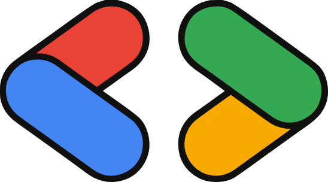

# GDGoC UNM — Design System & Project Context Specification

Dokumen ini adalah **panduan desain resmi (Design System & Architectural Context)** untuk seluruh ekosistem website **Google Developer Groups on Campus (GDGoC) Universitas Negeri Makassar (UNM)**.

Dokumen ini disusun berdasarkan implementasi nyata pada [`index.html`](file:///d:/Coding/gdgocunm/index.html), [`css/style.css`](file:///d:/Coding/gdgocunm/css/style.css), dan [`css/animations.css`](file:///d:/Coding/gdgocunm/css/animations.css). Seluruh halaman baru (seperti halaman photobooth, certificate verification, event showcase, project gallery, dsb.) **wajib** mengikuti pedoman, token desain, dan struktur komponen yang ada di sini untuk menjaga konsistensi visual dan pengalaman pengguna.

---

## 1. Brand Identity & Design Philosophy

### 1.1 Identitas Organisasi
- **Nama Komunitas**: Google Developer Groups on Campus (GDGoC) Universitas Negeri Makassar
- **Singkatan**: GDGoC UNM
- **Motto / Core Pillars**: `Learn • Build • Grow` (Belajar • Bangun • Berkembang)
- **Local Identity**: Menara Pinisi UNM (siluet arsitektur khas kampus yang disematkan secara elegan di ambient hero).

### 1.2 Filosofi Desain: "Dark Developer UI" (Google AI Studio Aesthetic)
Desain GDGoC UNM memadukan estetika *modern developer tool* seperti **Google AI Studio** dan **Google Cloud Console**, dengan elemen *frosted glassmorphism* dan 4 aksen warna resmi Google (*Google Quad-Color*):
1. **Dark & Focused**: Background gelap bertingkat (`#171B21`, `#111319`, `#161822`) yang nyaman di mata pengembang dan menonjolkan konten utama.
2. **Subtle Tech Textures**: Overlay grid geometris halus (`48px x 48px`) dengan radial mask dan ambient light gradients lembut (blur 80–100px).
3. **Google Quad-Color Accents**: Sentuhan warna Google (Biru, Merah, Kuning, Hijau) digunakan secara presisi sebagai aksen batas (border gradients), dot indikator, badge status, dan hover glow.
4. **Pill & Frosted Glass Surfaces**: Komponen navigation bar, tombol, badge, dan modal memanfaatkan `backdrop-filter: blur()`, rounded pills, dan gradien metalik gelap (`linear-gradient(55deg, #222222, #404040)`).

---

## 2. Design Tokens & CSS Variables

Seluruh variabel CSS didefinisikan pada root [`css/style.css`](file:///d:/Coding/gdgocunm/css/style.css#L6-L62):

```css
:root {
    /* Google Brand Colors */
    --google-blue: #4285f4;
    --google-red: #ea4335;
    --google-yellow: #fbbc04;
    --google-green: #34a853;

    /* Accent Bright Variants (Untuk teks atau badge di atas background gelap) */
    --blue-light: #8ab4f8;
    --red-light: #f28b82;
    --yellow-light: #fdd663;
    --green-light: #81c995;

    /* Ambient Glows */
    --blue-glow: rgba(66, 133, 244, 0.22);
    --red-glow: rgba(234, 67, 53, 0.22);
    --yellow-glow: rgba(251, 188, 4, 0.22);
    --green-glow: rgba(52, 168, 83, 0.22);

    /* Dark Theme Surface Palette */
    --bg-primary: #171B21;        /* Background dasar halaman */
    --bg-secondary: #111319;      /* Background kontras lebih gelap */
    --bg-tertiary: #161822;       /* Background section selang-seling */
    --bg-card: rgba(20, 23, 32, 0.78); /* Card standar transparan */
    --bg-card-hover: rgba(26, 30, 42, 0.92);
    --bg-glass: rgba(14, 16, 24, 0.82); /* Floating navigation & modal */

    /* Borders & Lines */
    --border-subtle: rgba(255, 255, 255, 0.08);
    --border-card: #232734;
    --border-card-hover: rgba(66, 133, 244, 0.45);
    --border-focus: #4285f4;

    /* Typography */
    --text-primary: #f5f7fc;      /* Judul dan teks utama */
    --text-secondary: #9aa0a6;    /* Deskripsi dan paragraf */
    --text-muted: #6b7280;        /* Label metadata, timestamp */
    --text-code: #bdc1c6;

    /* Font Families */
    --font-sans: "Google Sans", sans-serif;
    --font-mono: "Google Sans", sans-serif; /* Fallback konsisten */

    /* Border Radii */
    --radius-sm: 8px;
    --radius-md: 14px;
    --radius-lg: 20px;
    --radius-pill: 9999px;

    /* Elevation Shadows */
    --shadow-sm: 0 2px 8px rgba(0, 0, 0, 0.4);
    --shadow-md: 0 8px 24px rgba(0, 0, 0, 0.55);
    --shadow-lg: 0 16px 40px rgba(0, 0, 0, 0.7);

    /* Transition Timings */
    --transition-fast: 0.18s cubic-bezier(0.4, 0, 0.2, 1);
    --transition-normal: 0.28s cubic-bezier(0.4, 0, 0.2, 1);
    --transition-smooth: 0.4s cubic-bezier(0.16, 1, 0.3, 1);
}
```

### 2.1 Aturan Baku Palet Warna Tertutup (Strict Closed Color Palette Policy)

> [!CAUTION]
> **ATURAN MUTLAK: HANYA MENGGUNAKAN WARNA RESMI YANG SUDAH DITETAPKAN (DILARANG MEMAKAI WARNA DI LUAR PALET)**:
> Di seluruh ekosistem website GDGoC UNM, seluruh halaman, komponen, kartu, tombol, teks, background, border, glow, badge, modal, dan elemen interaktif **HANYA BOLEH MENGGUNAKAN PALET WARNA RESMI YANG TERCANTUM DI BAB INI**.
>
> **LARANGAN KERAS**:
> 1. **Dilarang memakai warna asing**: Jangan pernah memasukkan warna ungu (*purple*), cyan neon, pink/magenta, oranye non-Google, cokelat, atau warna acak lain di luar palet resmi.
> 2. **Dilarang menulis kode HEX/RGB acak**: Pengembang dan AI **WAJIB** memanggil token CSS variable yang sudah ada (`var(--token-name)`). Jangan menuliskan hardcoded hex yang berbeda seperti `#1e2025`, `#0f172a`, `#1a202c`, dsb.
> 3. **Aksen warna HANYA Google Quad-Color**: Setiap aksen grafis, badge kategori, indikator, atau status **HANYA** boleh memilih satu dari 4 warna resmi Google (Biru, Merah, Kuning, Hijau) atau varian terang (*light variants*) resminya.

---

### 2.2 Tabel Master Direktori Palet Warna Resmi

Berikut adalah daftar lengkap dan tertutup (*exhaustive closed palette*) seluruh warna yang diizinkan di ekosistem GDGoC UNM:

#### 1. Google Quad-Color Brand & Accent Tokens
Digunakan untuk aksen garis, border gradient, dot status, badge kategori, dan glow interaktif:

| Kategori | Token CSS | Nilai Warna | Preview | Peruntukan Utama |
| :--- | :--- | :--- | :--- | :--- |
| **Google Blue** | `--google-blue` | `#4285f4` | 🟦 | Aksen primer, focus border input, active indicator |
| **Blue Light** | `--blue-light` | `#8ab4f8` | 🔹 | Teks aksen biru di atas gelap, badge teks workshop |
| **Blue Glow** | `--blue-glow` | `rgba(66, 133, 244, 0.22)` | 💡 | Box shadow focus & hover glow biru |
| **Blue Tint** | *Surface Tint* | `rgba(66, 133, 244, 0.12)` | ◽ | Background badge / alert info |
| **Google Red** | `--google-red` | `#ea4335` | 🟥 | Aksen merah, border error, alert failure |
| **Red Light** | `--red-light` | `#f28b82` | 🔸 | Teks alert error di atas gelap, badge teks kompetisi |
| **Red Glow** | `--red-glow` | `rgba(234, 67, 53, 0.22)` | 💡 | Hover glow aksen merah |
| **Red Tint** | *Surface Tint* | `rgba(234, 67, 53, 0.12)` | ◽ | Background alert error / destructive pill |
| **Google Yellow** | `--google-yellow` | `#fbbc04` | 🟨 | Aksen kuning, warning badge, highlight |
| **Yellow Light** | `--yellow-light` | `#fdd663` | ▫️ | Teks warning di atas gelap, badge showcase |
| **Yellow Glow** | `--yellow-glow` | `rgba(251, 188, 4, 0.22)` | 💡 | Hover glow aksen kuning |
| **Yellow Tint** | *Surface Tint* | `rgba(251, 188, 4, 0.12)` | ◽ | Background badge kuning |
| **Google Green** | `--google-green` | `#34a853` | 🟩 | Aksen hijau, success indicator, verified badge |
| **Green Light** | `--green-light` | `#81c995` | 🔹 | Teks alert success di atas gelap, badge study jam |
| **Green Glow** | `--green-glow` | `rgba(52, 168, 83, 0.22)` | 💡 | Hover glow aksen hijau |
| **Green Tint** | *Surface Tint* | `rgba(52, 168, 83, 0.12)` | ◽ | Background alert success |

#### 2. Dark Surface & Background Hierarchy
Digunakan untuk struktur layering halaman agar konsisten dengan estetika *Google AI Studio*:

| Token CSS | Nilai Warna | Peruntukan & Hirarki |
| :--- | :--- | :--- |
| `--bg-primary` | `#171B21` | Latar belakang utama seluruh halaman web (body base). |
| `--bg-secondary` | `#111319` | Latar belakang input form keadaan normal, kontras lebih pekat. |
| `--bg-tertiary` | `#161822` | Latar belakang input form saat `:focus`, baris selang-seling tabel. |
| `--bg-card` | `rgba(20, 23, 32, 0.78)` | Kartu standar transparan dengan `backdrop-filter: blur(14px)`. |
| `--bg-card-hover` | `rgba(26, 30, 42, 0.92)` | Kartu saat kursor hover. |
| `--bg-glass` | `rgba(14, 16, 24, 0.82)` | Surface floating navigation bar & container modal. |
| *Dark Metallic Glass* | `linear-gradient(145deg, rgba(24, 27, 36, 0.94) 0%, rgba(17, 19, 27, 0.98) 100%)` | Kartu login, panel admin, kartu fitur utama. |
| *Dark Capsule Button* | `linear-gradient(55deg, #222222 0%, #222222 68%, #404040 100%)` | Background tombol sekunder (`.btn-secondary`). |

#### 3. Typography & Text Hierarchy Tokens

| Token CSS | Nilai Warna | Peruntukan |
| :--- | :--- | :--- |
| `--text-primary` | `#f5f7fc` (atau `#ffffff`) | Judul (`h1`, `h2`, `h3`), label aktif, teks utama kartu. |
| `--text-secondary` | `#9aa0a6` | Paragraf pengantar, deskripsi isi, ikon normal, tautan non-aktif. |
| `--text-muted` | `#6b7280` | Placeholder input, tanggal kegiatan, teks metadata, label counter. |
| `--text-code` | `#bdc1c6` | Teks monospace, slug URL, ID teknis, badge kode. |

#### 4. Border, Line, & Stroke Tokens

| Token CSS | Nilai Warna | Peruntukan |
| :--- | :--- | :--- |
| `--border-subtle` | `rgba(255, 255, 255, 0.08)` | Garis batas tipis, divider horizontal, garis pemisah header footer. |
| `--border-card` | `#232734` | Border baku kartu, border normal input form, border modal. |
| `--border-card-hover` | `rgba(66, 133, 244, 0.45)` | Border kartu saat di-hover (memunculkan sentuhan biru Google). |
| `--border-focus` | `#4285f4` | Border form control saat keadaan fokus aktif (`:focus`). |

#### 5. Signature Google Quad-Color Accent Strip
Garis aksen 4 warna resmi Google dengan proporsi seimbang:
```css
/* Signature Google Quad-Color Linear Gradient */
background: linear-gradient(90deg, #ea4335 0%, #fbbc04 34%, #34a853 67%, #4285f4 100%);
```
- **Ketebalan standar**: `3px` di bagian tepi paling atas kartu (`.login-card::before`, `.event-card::before`, dsb.) atau sebagai `border-box` transparan pada `.nav-inner`.

#### 6. Button Surface Colors (Hanya 2 Tipe)
- **Tombol Utama (`.btn-primary`)**:
  - Background: `linear-gradient(180deg, #ffffff 0%, #a4a4a4 100%)`
  - Teks: `#111111` (hitam pekat kontras)
  - Border: `1px solid rgba(255, 255, 255, 0.6)`
- **Tombol Sekunder (`.btn-secondary`)**:
  - Background: `linear-gradient(55deg, #222222 0%, #222222 68%, #404040 100%)`
  - Teks: `#f5f7fc`
  - Border: `1.5px solid rgba(255, 255, 255, 0.12)` (hover: border gradien 4 warna Google)

---

## 3. Global Background & Tech Grid Layer

Setiap halaman di proyek ini **wajib** menggunakan lapisan background global berikut:

### 3.1 Struktur HTML Background Layer
Letakkan tepat setelah tag pembuka `<body>`:
```html
<body id="top">
    <!-- Tech Grid Lines Overlay (Satu-satunya background overlay yang diizinkan) -->
    <div class="tech-grid-overlay" aria-hidden="true"></div>

    <!-- Konten Halaman Dimulai Di Sini -->
</body>
```

> [!CAUTION]
> **DILARANG MENGGUNAKAN AMBIENT GLOW WARNA GOOGLE (`.ambient-glow` / `.ambient-bottom-glow`)**:
> **JANGAN PERNAH** menambahkan elemen `<div class="ambient-glow">`, `.ambient-bottom-glow`, atau div lingkaran gradien warna Google (merah, biru, kuning, hijau dengan blur besar) di latar belakang halaman baru!
> Glow warna-warni yang menyebar di background membuat tampilan halaman kotor, tidak profesional, dan merusak keterbacaan teks.
> Latar belakang halaman **HANYA** berupa dark surface `#171B21` bersih dengan **satu-satunya overlay** yaitu `<div class="tech-grid-overlay" aria-hidden="true"></div>`.

### 3.2 Spesifikasi CSS Lapis Background
- **Body Background**:
  ```css
  body {
      background: linear-gradient(180deg, #181818 0%, #171b21 100%) no-repeat fixed;
      background-color: #171b21;
      color: var(--text-primary);
      font-family: var(--font-sans);
  }
  ```
- **`.tech-grid-overlay`**: Grid geometris berukuran `48px x 48px` dengan garis transparan `rgba(255, 255, 255, 0.02)` dan radial mask untuk efek vignette modern.

### 3.3 Container Layout
Gunakan class `.container` untuk membatasi lebar konten:
```css
.container {
    width: 100%;
    max-width: 1220px;
    margin: 0 auto;
    padding: 0 24px;
    position: relative;
    z-index: 1;
}
```

---

## 4. Typography Hierarchy & Text Styles

| Level | Elemen / Class | Font Size (Desktop) | Weight | Letter Spacing | Warna | Keterangan |
| :--- | :--- | :--- | :--- | :--- | :--- | :--- |
| **Hero Display** | `.hero-title` | `3.5rem` (56px) | 800 | `-0.03em` | `#ffffff` | Judul utama halaman landing |
| **Section Title** | `.section-title` | `2.4rem` (38px) | 700 | `-0.02em` | `var(--text-primary)` | Judul tiap bagian/seksi |
| **Card Header** | `h3` / `.card-title` | `1.3rem - 1.5rem` | 700 | `-0.01em` | `#ffffff` | Judul dalam card |
| **Subtitle** | `.section-subtitle` | `1.05rem` (17px) | 400 | Normal | `var(--text-secondary)` | Penjelas di bawah section title |
| **Body Paragraph**| `p` / `.body-text` | `0.94rem - 1.0rem` | 400 | Normal | `var(--text-secondary)` | Line height: 1.6 - 1.65 |
| **Tag / Pill Label**| `.section-tag`, `.badge-pill` | `0.78rem - 0.82rem`| 600 | `+0.04em` | Beragam (Google Aksen)| Uppercase/Cap status pill |
| **Caption / Meta** | `.stat-sub`, `.team-major` | `0.76rem - 0.78rem`| 500 | Normal | `var(--text-muted)` | Keterangan tambahan |

### 4.1 Kebersihan Header & Larangan Badge Artifisial

> [!WARNING]
> **KEBERSIHAN HEADER (DILARANG KERAS MENAMBAH BADGE / PILL ARTIFISIAL)**:
> Jangan menambahkan badge/pill artifisial atau dekorasi teks uppercase berlebihan (seperti `ACTIVITIES & DOCUMENTATION`, `STUDIO CONFIG`, atau label buatan serupa) di atas judul seksi atau judul halaman (`h1` / `h2`).
> Header halaman, seksi, panel, form, atau kartu interaktif **harus bersih, minimalis, dan elegan**: langsung berfokus pada judul (`h1` / `h2`) serta paragraf deskripsi pengantar (`p.section-subtitle`) tanpa badge yang mengotori tampilan.

> [!CAUTION]
> **ATURAN BAHASA ANTARMUKA (STRICT ENGLISH UI COPY POLICY)**:
> Seluruh teks antarmuka publik pada website GDGoC UNM **WAJIB MENGGUNAKAN BAHASA INGGRIS (100% ENGLISH)**:
> - Judul dan subjudul seksi (misal: *Activities & Event Gallery*, *Frequently Asked Questions*).
> - Label navigasi dan tombol CTA (misal: *Explore Full Gallery*, *Register Member*, *View Album*, *View All*).
> - Placeholder input form dan search bar (misal: *Search activities, workshops, or topics...*).
> - Tab kategori dan status counter (misal: *All Activities*, *Loading activities...*, *6 Albums • 6 Photos*).
> - Dialog modal, aria-labels, dan notifikasi (misal: *Activity Title*, *Photo 1 of 1*, *Close Lightbox*).
> 
> *Bahasa Indonesia HANYA diperbolehkan untuk nama resmi organisasi/institusi kampus (`Universitas Negeri Makassar`, `Menara Pinisi`) atau judul kegiatan lokal jika secara resmi dinamai dalam bahasa Indonesia oleh panitia.*

> [!CAUTION]
> **DILARANG MENGGUNAKAN EMOJI (STRICT NO-EMOJI POLICY)**:
> Seluruh elemen antarmuka, teks tombol, opsi dropdown select, label, badge, modal, dan notifikasi toast **DILARANG KERAS** menggunakan karakter emoji (seperti 📸, ☀️, 🎞️, 📼, ⚡, 💾, 🚀, dll.).
> Gunakan ikon SVG garis bersih (*clean stroke SVG*) yang terukur dan profesional, atau gunakan teks teknis/deskriptif yang lugas.

### 4.2 Standard Clean Section Header Template
Format baku header yang bersih untuk halaman landing maupun halaman spesifik:
```html
<div class="section-header">
    <h1 class="section-title">Activities & Event Gallery</h1>
    <p class="section-subtitle">
        A curated showcase of memorable moments, technical workshops, hackathons, and community study jams at Google Developer Groups on Campus Universitas Negeri Makassar.
    </p>
</div>
```

---

## 5. UI Component Library (HTML & CSS Blueprints)

### 5.1 Modular Architecture: External Navbar & Footer Components

Untuk menjamin konsistensi 100% di semua halaman website tanpa duplikasi ratusan baris HTML, navigasi header dan footer dikelola melalui **komponen eksternal modular**:
- `components/navbar.html`: Berisi struktur kanonik `.site-header`, logo branding, desktop `.nav-links`, tombol `.btn-primary` (Register Member), tombol hamburger `.mobile-toggle`, serta `.mobile-nav-backdrop` dan `.mobile-nav-drawer`.
- `components/footer.html`: Berisi struktur kanonik `.site-footer`, deskripsi brand, link navigasi, tautan sosial media resmi, dan baris copyright `footer-bottom`.
- `js/components.js`: Skrip loader komponen universal yang secara otomatis menginjeksi navbar dan footer secara instan dan bersih, menangani deteksi link aktif (`.active`), interaksi mobile drawer, dan smooth scrolling.

#### Cara Menggunakan di Setiap Halaman:
```html
<!-- Di bagian atas <body> -->
<div id="navbar-placeholder"></div>

<!-- Konten halaman -->
<main>...</main>

<!-- Di bagian bawah <body> -->
<div id="footer-placeholder"></div>

<!-- Scripts -->
<script src="js/components.js"></script>
```

#### Struktur Blueprint Navbar Kanonik:
```html
<header class="site-header" id="main-header">
    <div class="container">
        <nav class="nav-inner" aria-label="Main Navigation">
            <!-- Brand Logo -->
            <a href="index.html#hero" class="nav-brand">
                <div class="nav-logo-icon">
                    
                </div>
                <div class="nav-brand-text">
                    <span class="nav-brand-title">
                        GDGoC <span class="campus-tag">UNM</span>
                    </span>
                    <span class="nav-brand-sub">Universitas Negeri Makassar</span>
                </div>
            </a>

            <!-- Desktop Links (English Standard) -->
            <ul class="nav-links">
                <li><a href="index.html#about" class="nav-link" data-nav="about">About</a></li>
                <li><a href="index.html#events" class="nav-link" data-nav="events">Events</a></li>
                <li><a href="learning-path.html" class="nav-link" data-nav="learning-path">Learning Path</a></li>
                <li><a href="index.html#team" class="nav-link" data-nav="team">Team</a></li>
                <li><a href="gallery.html" class="nav-link" data-nav="gallery">Gallery</a></li>
                <li><a href="index.html#faq" class="nav-link" data-nav="faq">FAQ</a></li>
            </ul>

            <!-- Actions & Mobile Toggle -->
            <div class="nav-actions">
                <a href="https://gdg.community.dev/gdg-on-campus-universitas-negeri-makassar-makassar-indonesia/" target="_blank" rel="noopener noreferrer" class="btn-primary" id="btn-nav-join">
                    <span>Register Member</span>
                    <svg width="14" height="14" viewBox="0 0 24 24" fill="none" stroke="currentColor" stroke-width="2.5">
                        <path d="M5 12h14M12 5l7 7-7 7" />
                    </svg>
                </a>
                <button class="mobile-toggle" id="mobile-toggle-btn" aria-label="Toggle navigation menu" aria-expanded="false">
                    <span class="hamburger-line"></span>
                    <span class="hamburger-line"></span>
                    <span class="hamburger-line"></span>
                </button>
            </div>
        </nav>
    </div>
</header>

<!-- Mobile Navigation Drawer & Backdrop -->
<div class="mobile-nav-backdrop" id="mobile-nav-backdrop" aria-hidden="true"></div>
<div class="mobile-nav-drawer" id="mobile-nav-drawer" role="dialog" aria-modal="true" aria-label="Mobile Navigation">
    <div class="mobile-nav-menu-list">
        <a href="index.html#about" class="nav-link" data-nav="about"><span>About</span>...</a>
        <a href="index.html#events" class="nav-link" data-nav="events"><span>Events</span>...</a>
        <a href="learning-path.html" class="nav-link" data-nav="learning-path"><span>Learning Path</span>...</a>
        <a href="index.html#team" class="nav-link" data-nav="team"><span>Team</span>...</a>
        <a href="gallery.html" class="nav-link" data-nav="gallery"><span>Gallery</span>...</a>
        <a href="index.html#faq" class="nav-link" data-nav="faq"><span>FAQ</span>...</a>
    </div>
    <div class="mobile-drawer-cta-box">
        <a href="https://gdg.community.dev/gdg-on-campus-universitas-negeri-makassar-makassar-indonesia/" target="_blank" rel="noopener noreferrer" class="btn-primary" style="text-align: center; justify-content: center; padding: 12px 20px;">
            <span>Register Member</span>
            <svg width="14" height="14" viewBox="0 0 24 24" fill="none" stroke="currentColor" stroke-width="2.5"><path d="M5 12h14M12 5l7 7-7 7" /></svg>
        </a>
    </div>
</div>
```

**Kunci CSS Navbar**:
- **Posisi Menetap di Atas (Static / Absolute Header — Tidak Mengikuti Saat Scroll)**:
  - Navbar menggunakan `position: absolute;` (bukan `fixed` atau `sticky`), dengan `top: 16px; left: 0; right: 0; z-index: 100;` (pada layar mobile `<= 560px`: `top: 8px;`).
  - **Aturan Mutlak**: Navbar **WAJIB MENETAP DI ATAS** dan **DILARANG MENGIKUTI LAYAR SAAT DI-SCROLL** agar seluruh halaman bersih, fokus, dan tidak ada floating header yang menghalangi keterbacaan konten saat pengguna menggulir ke bawah.
- `background: linear-gradient(55deg, #222222 0%, #222222 68%, #404040 100%) padding-box, linear-gradient(90deg, #ea4335 0%, #fbbc04 34%, #34a853 67%, #4285f4 100%) border-box;`
- `border: 1.82px solid transparent;`
- `backdrop-filter: blur(20px);`
- `border-radius: var(--radius-pill);`

---

### 5.2 Button System

> [!IMPORTANT]
> **ATURAN MUTLAK SISTEM TOMBOL (HANYA DUA TIPE BACKGROUND)**:
> Di seluruh ekosistem website GDGoC UNM, seluruh tombol **HANYA MEMILIKI DUA (2) TIPE GAYA BACKGROUND**:
> 1. **Style Putih (`.btn-primary`)**: Background gradien putih metalik (`linear-gradient(180deg, #ffffff 0%, #a4a4a4 100%)`) dengan teks hitam `#111111` dan border `1px solid rgba(255, 255, 255, 0.5 - 0.6)`. Digunakan untuk seluruh **Aksi Utama / CTA Primer** (misal: "Gabung Sekarang", "Continue to Camera", "Download HD Photo", "Auto-Sequence").
> 2. **Style Hitam (`.btn-secondary`)**: Background gradien kapsul gelap (`linear-gradient(55deg, #222222 0%, #222222 68%, #404040 100%)`) dengan teks terang `#f5f7fc` dan border `1.5px solid rgba(255, 255, 255, 0.12)` yang memunculkan bingkai gradien 4 warna Google saat di-hover. Digunakan untuk seluruh **Aksi Alternatif / Sekunder** (misal: "Pelajari Lebih Lanjut", "Change Settings", "Reset", "Retake Photos").
>
> **DILARANG KERAS**:
> - Membuat tombol dengan background berwarna solid (seperti tombol berlatar biru `#4285f4`, hijau `#34a853`, merah `#ea4335`, atau warna lainnya).
> - Seluruh aksen warna Google (biru, merah, kuning, hijau) HANYA boleh hadir sebagai aksen garis (border gradient), indikator dot, atau bayangan hover glow, **BUKAN** sebagai warna background tombol!

#### 1. Primary Button — Style Putih (`.btn-primary`)
Digunakan untuk aksi utama (CTA terpenting, Submit, Gabung, Konfirmasi, Download HD). Tampilan gradien putih metalik dengan teks gelap yang sangat kontras:
```html
<a href="#" class="btn-primary">
    <span>Aksi Utama</span>
    <svg width="14" height="14" viewBox="0 0 24 24" fill="none" stroke="currentColor" stroke-width="2">
        <line x1="5" y1="12" x2="19" y2="12"></line>
        <polyline points="12 5 19 12 12 19"></polyline>
    </svg>
</a>
```
- **Styling**:
  ```css
  .btn-primary {
      display: inline-flex;
      align-items: center;
      gap: 8px;
      padding: 10px 22px;
      border-radius: var(--radius-pill);
      font-size: 0.92rem;
      font-weight: 700;
      background: linear-gradient(180deg, #ffffff 0%, #a4a4a4 100%);
      color: #111111;
      border: 1px solid rgba(255, 255, 255, 0.6);
      cursor: pointer;
      box-shadow: 0 4px 14px rgba(0, 0, 0, 0.25);
      transition: all var(--transition-normal);
  }
  .btn-primary:hover {
      background: linear-gradient(180deg, #ffffff 0%, #b8b8b8 100%);
      color: #000000;
      transform: translateY(-2px);
      box-shadow: 0 6px 20px rgba(255, 255, 255, 0.2), 0 4px 12px rgba(0, 0, 0, 0.3);
  }
  ```

#### 2. Secondary Button — Style Hitam (`.btn-secondary`)
Digunakan untuk aksi alternatif (Eksplorasi, Pelajari Lebih Lanjut, Batal, Pengaturan). Tampilan kapsul gelap dengan hover yang memunculkan bingkai 4 warna Google:
```html
<a href="#" class="btn-secondary">
    <span>Pelajari Lebih Lanjut</span>
</a>
```
- **Styling**:
  ```css
  .btn-secondary {
      display: inline-flex;
      align-items: center;
      gap: 8px;
      padding: 9px 18px;
      border-radius: var(--radius-pill);
      font-size: 0.86rem;
      font-weight: 500;
      border: 1.5px solid rgba(255, 255, 255, 0.12);
      background: linear-gradient(55deg, #222222 0%, #222222 68%, #404040 100%);
      color: var(--text-primary);
      cursor: pointer;
      box-shadow: 0 4px 14px rgba(0, 0, 0, 0.25);
      transition: all var(--transition-normal);
  }
  .btn-secondary:hover {
      border: 1.5px solid transparent;
      background:
          linear-gradient(55deg, #2a2a2a 0%, #2a2a2a 68%, #484848 100%) padding-box,
          linear-gradient(90deg, #ea4335 0%, #fbbc04 34%, #34a853 67%, #4285f4 100%) border-box;
      color: #ffffff;
      box-shadow: 0 6px 20px rgba(0, 0, 0, 0.45), 0 0 16px rgba(66, 133, 244, 0.25);
  }
  ```

#### 3. Circular Action / Social Button (`.social-icon-btn` & `.tracks-carousel-arrow`)
Mengikuti style hitam atau putih bulat:
```html
<button class="tracks-carousel-arrow" aria-label="Next">
    <svg width="20" height="20" viewBox="0 0 24 24" fill="none" stroke="currentColor" stroke-width="2">
        <polyline points="9 18 15 12 9 6"></polyline>
    </svg>
</button>
```

---

### 5.3 Badges, Tags, & Status Pills

#### 1. Google 4-Color Dots
```html
<div class="mini-logo-dots">
    <span class="dot-blue"></span>
    <span class="dot-red"></span>
    <span class="dot-yellow"></span>
    <span class="dot-green"></span>
</div>
```

#### 2. Category / Activity Badges
```html
<span class="activity-badge badge-blue">Workshop</span>
<span class="activity-badge badge-red">Competition</span>
<span class="activity-badge badge-green">Study Group</span>
<span class="activity-badge badge-yellow">Showcase</span>
```

#### 3. Tech Tag Pill (Monochrome Chip)
```html
<div class="activity-tags">
    <span class="tag-pill">Flutter</span>
    <span class="tag-pill">Firebase</span>
    <span class="tag-pill">Google Cloud</span>
</div>
```

#### 4. Motto Slogan Pill
```html
<div class="slogan-highlight-pill">
    <span class="l-word">Learn</span> • 
    <span class="b-word">Build</span> • 
    <span class="g-word">Grow</span>
</div>
```

---

### 5.4 Card Surfaces & Styles

#### Pola Card Standar (Dark Metallic Glass)
Semua card di ekosistem ini menggunakan gradien sudut 55 derajat khas:
```html
<div class="card-metallic">
    <!-- Card Content -->
</div>
```
```css
.card-metallic {
    background: linear-gradient(55deg, #222222 0%, #222222 68%, #404040 100%);
    backdrop-filter: blur(14px);
    border: 1px solid rgba(255, 255, 255, 0.12);
    border-radius: var(--radius-lg);
    box-shadow: 0 4px 16px rgba(0, 0, 0, 0.3);
    transition: all var(--transition-normal);
}

.card-metallic:hover {
    transform: translateY(-4px);
    border-color: rgba(255, 255, 255, 0.25);
    box-shadow: 0 12px 30px rgba(0, 0, 0, 0.5);
}
```

#### 3 Pilar Card (Belajar, Bangun, Berkembang)
Setiap pilar memiliki ikon kotak dengan latar belakang warna Google:
- **Biru (Belajar)**: `.pillar-icon-box.blue` (`background: rgba(66, 133, 244, 0.15); color: #8ab4f8;`)
- **Hijau (Bangun)**: `.pillar-icon-box.green` (`background: rgba(52, 168, 83, 0.15); color: #81c995;`)
- **Kuning (Berkembang)**: `.pillar-icon-box.yellow` (`background: rgba(251, 188, 4, 0.15); color: #fdd663;`)

#### Photostrip Frame & Gradient Stroke Slot Pattern
Untuk modul visual/photostrip, permukaan frame mengadopsi dark metallic glass dengan garis aksen Google dan stroke gradien pada slot foto:
- **Frame Background**: `linear-gradient(55deg, #222222 0%, #222222 68%, #404040 100%)` dengan 3px top Google quad-color accent line.
- **Photo Slot Gradient Stroke**:
  ```css
  .photo-slot-gradient {
      padding: 1.5px;
      border-radius: 7px;
      background: linear-gradient(135deg, #ea4335 0%, #fbbc04 34%, #34a853 67%, #4285f4 100%);
      box-shadow: 0 4px 16px rgba(0, 0, 0, 0.55);
      box-sizing: border-box;
  }
  .photo-slot-gradient img {
      width: 100%;
      height: 100%;
      border-radius: 5.5px;
      display: block;
      object-fit: cover;
  }
  ```

---

### 5.5 Learning Path Carousel (1-Row Horizontal Slider)
Pola carousel responsif 1 baris dengan kontrol panah kiri/kanan dan kartu interaktif:
- **Desktop besar**: Menampilkan 4 kartu per viewport (`flex: 0 0 calc((100% - 60px) / 4);`).
- **Tablet**: Menampilkan 2–3 kartu per viewport.
- **Mobile**: Menampilkan 1 kartu lebar penuh (`flex: 0 0 85%;`) dengan swipe / touch gesture.

---

### 5.6 Accordion (FAQ Pattern)
Komponen FAQ yang bersih dengan panah SVG yang berputar mulus saat dibuka:
```html
<div class="faq-list">
    <div class="faq-item">
        <button class="faq-question" aria-expanded="false">
            <span>Apakah saya harus mahasiswa jurusan IT untuk bergabung?</span>
            <svg class="faq-icon" width="20" height="20" viewBox="0 0 24 24" fill="none" stroke="currentColor" stroke-width="2">
                <polyline points="6 9 12 15 18 9"></polyline>
            </svg>
        </button>
        <div class="faq-answer">
            <p>Tidak! GDGoC UNM terbuka untuk seluruh mahasiswa aktif UNM dari fakultas dan jurusan apa pun yang tertarik pada teknologi.</p>
        </div>
    </div>
</div>
```
---

### 5.8 Canonical Ecosystem Footer (`.site-footer`)
Footer universal yang dipanggil via `<div id="footer-placeholder"></div>` dan `js/components.js`:
```html
<footer class="site-footer">
    <div class="container">
        <div class="footer-top">
            <div class="footer-brand">
                <div class="footer-brand-header">
                    
                </div>
                <p>Google Developer Group On Campus Universitas Negeri Makassar. An independent student community fostering tech innovation, peer learning, and collaborative digital solutions.</p>
            </div>
            
            <div class="footer-nav-wrapper">
                <div class="footer-col">
                    <h4>Navigation</h4>
                    <ul class="footer-links">
                        <li><a href="index.html#about">About</a></li>
                        <li><a href="index.html#events">Events</a></li>
                        <li><a href="learning-path.html">Learning Path</a></li>
                        <li><a href="index.html#team">Core Team</a></li>
                        <li><a href="gallery.html">Activities Gallery</a></li>
                        <li><a href="index.html#faq">FAQ</a></li>
                    </ul>
                </div>
                <div class="footer-col">
                    <h4>Contact</h4>
                    <ul class="footer-links footer-contact-links">
                        <li><a href="mailto:gdgoc.unm@gmail.com" target="_blank" rel="noopener noreferrer">...<span>Email</span></a></li>
                        <li><a href="https://instagram.com/gdgoc.unm" target="_blank" rel="noopener noreferrer">...<span>Instagram</span></a></li>
                        <li><a href="https://discord.gg/gdgoc-unm" target="_blank" rel="noopener noreferrer">...<span>Discord</span></a></li>
                        <li><a href="https://tiktok.com/@gdgoc.unm" target="_blank" rel="noopener noreferrer">...<span>TikTok</span></a></li>
                        <li><a href="https://youtube.com/@gdgoc-unm" target="_blank" rel="noopener noreferrer">...<span>YouTube</span></a></li>
                    </ul>
                </div>
            </div>
        </div>

        <div class="footer-bottom">
            <div>
                &copy; 2026 <strong>GDGoC UNM</strong>. All Rights Reserved
            </div>
        </div>
    </div>
</footer>
```

---

## 6. Iconography & Media Asset Rules

### 6.1 Direktori Aset Resmi
- **Logo Utama**: `assets/images/gdgoc-logo.webp` (Logo teks lengkap + brackets)
- **Logo Simbol**: `assets/images/logo-gdgoc.png` (Simbol kurung kurawal 4 warna)
- **Local Backdrop**: `assets/images/pinisi-tower.png` (Siluet Menara Pinisi transparan)
- **Tim Core**: `assets/images/team/lead.webp`, dll.

### 6.2 Icon Guidelines
- Gunakan **SVG inline** dengan atribut:
  `stroke="currentColor" stroke-width="2" stroke-linecap="round" stroke-linejoin="round" fill="none"`
- Ukuran standar ikon tombol: `14px` x `14px` atau `16px` x `16px`.
- Ukuran standar ikon kartu/navigasi: `20px` x `20px` atau `24px` x `24px`.
- Hindari pemakaian font icon eksternal yang lambat dimuat (mis. FontAwesome CDN berat); prioritaskan SVG bersih agar halaman instan dirender.

---

## 7. Responsive Breakpoint Standards

Sistem breakpoint GDGoC UNM:

| Breakpoint | Target Layar | Perilaku Layout |
| :--- | :--- | :--- |
| **`> 1200px`** | Desktop Besar | Container maksimal `1220px`, 4 kolom track card, 2 kolom seimbang hero & about. |
| **`992px - 1199px`** | Desktop Sedang / Laptop | Carousel menampilkan 3 kartu per row, navigasi desktop tetap utuh. |
| **`768px - 991px`** | Tablet Landscape/Portrait | Hero beralih menjadi vertikal tersusun, grid 2 kolom, navbar berubah ke hamburger toggle. |
| **`< 768px`** | Smartphone Standar | Navigasi berpindah penuh ke `.mobile-nav-drawer` dengan backdrop blur. Grid beralih ke 1 kolom. Padding container mengecil ke `16px`. Tombol hero menjadi stack vertikal atau full-width. |
| **`< 480px`** | Smartphone Kecil | Font clamp otomatis menyesuaikan (`clamp(1.8rem, 7vw, 2.4rem)`). Carousel swipe touch diaktifkan penuh. |

---

## 8. Panduan Implementasi Halaman Baru (Checklist)

Saat Anda atau agen AI membuat halaman baru di repositori ini (misal `events.html`, `verify.html`, `photobooth.html`), pastikan:

1. [ ] **Head Tag Lengkap**: Mengimpor font `'Google Sans'`, favicon resmi GDGoC, meta viewport, dan link ke `css/style.css` serta `css/animations.css`.
2. [ ] **Background Overlay (Tanpa Ambient Glow)**: Memasang HANYA `<div class="tech-grid-overlay" aria-hidden="true"></div>` di awal tag `<body>`. DILARANG KERAS memasang `.ambient-glow` atau elemen glow warna Google di background.
3. [ ] **Header & Footer Modular**: Menggunakan placeholder `<div id="navbar-placeholder"></div>` dan `<div id="footer-placeholder"></div>` serta mengimpor `js/components.js`.
4. [ ] **Kebersihan Header (No Artificial Badges)**: Header langsung menampilkan `h1`/`h2.section-title` dan `p.section-subtitle` tanpa badge/pill artifisial atau teks uppercase berulang di atasnya.
5. [ ] **Strict English UI (100% Bahasa Inggris)**: Seluruh teks judul, deskripsi, tombol, placeholder, modal, dan status wajib menggunakan bahasa Inggris.
6. [ ] **Aturan Baku Palet Warna Tertutup (Strict Closed Palette)**: HANYA gunakan warna resmi yang terdaftar di Bab 2. DILARANG KERAS menggunakan warna di luar daftar ini (seperti ungu, cyan neon, pink, oranye non-Google, cokelat, dsb.) atau menulis kode HEX/RGB acak baru. Seluruh styling wajib memanggil CSS variables resmi (`--google-blue`, `--bg-primary`, `--bg-card`, `--border-card`, dsb.).
7. [ ] **Buttons & Actions (Aturan 2 Tipe)**: HANYA gunakan Style Putih (`.btn-primary`) untuk aksi utama dan Style Hitam (`.btn-secondary`) untuk aksi sekunder. DILARANG membuat tombol dengan background solid.
8. [ ] **No Emojis Policy**: DILARANG keras menggunakan karakter emoji pada teks UI/tombol/modal/badge. Gunakan SVG inline bersih.
9. [ ] **Mobile Responsiveness**: Uji tampilan pada viewport mobile (`< 480px`) agar tidak terjadi horizontal overflow dan menu drawer berfungsi lancar.

---

*Dokumen ini diperbarui secara berkala sebagai panduan resmi pengembangan website GDGoC UNM.*
